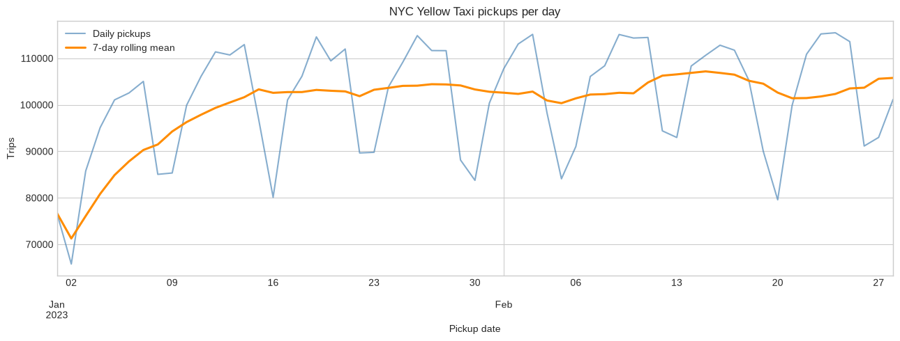
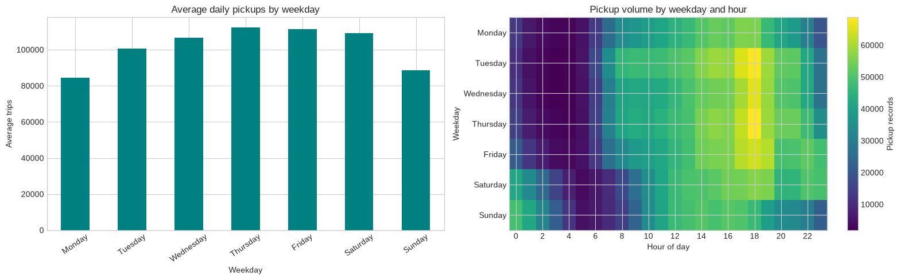
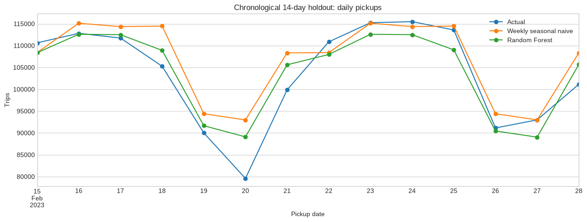
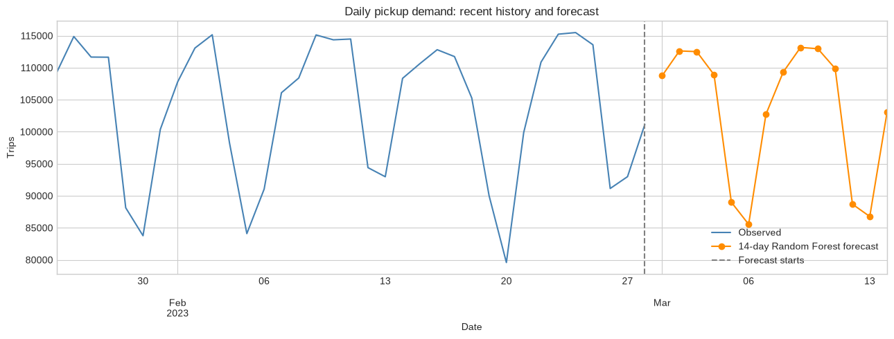

# Taxi-Rides Project

This project collects NYC Yellow Taxi trip records and uses the gathered pickup timestamps to explore demand trends and build a short-horizon machine-learning forecast. The analysis is in the [forecasting notebook](notebooks/taxi_demand_forecasting.ipynb).

## At a Glance

- **Dataset:** 5,980,729 pickup records from January 1 to February 28, 2023.
- **Forecast target:** Daily pickup counts (demand), not trip duration or fares.
- **Analysis:** Daily trend, weekday and hourly patterns, and a 14-day forecast.
- **Limitations:** Two months of observations are not enough to establish annual seasonality or reliable long-term forecasts.

## Demand Trends

Daily demand averaged 98,927 pickups in January and 104,072 in February. Thursday had the highest average daily pickups (about 112,273), while Monday had the lowest (about 84,601). Across the full period, 6 p.m. was the busiest pickup hour and 4 a.m. the quietest.

<table>
  <tr>
    <td colspan="2"><strong>Daily pickups</strong> Observed daily counts and their 7-day rolling mean.

</td>
  </tr>
  <tr>
    <td width="65%"></td>
    <td width="35%"><strong>Weekday and hourly profile</strong> Average daily pickups vary by weekday, and pickup counts also show a clear within-day pattern across the two observed months.</td>
  </tr>
</table>

## Machine-Learning Forecast

A Random Forest Regressor uses lagged daily counts (1, 7, and 14 days), trailing averages, weekday features, and a time index. The last 14 observed days were held out in chronological order. Predictions were recursive, so each predicted day was used to form the following day's lag features.

| Model | MAE (trips) | RMSE (trips) | sMAPE |
|---|---:|---:|---:|
| Weekly seasonal-naive baseline | 4,122.43 | 5,626.06 | 4.12% |
| Random Forest | **3,289.64** | **4,027.13** | **3.30%** |

On this single 14-day holdout, the Random Forest had lower errors than the weekly baseline. This short evaluation does not establish that it will generalize to other months or years.

After evaluation, the Random Forest was refit on all observed dates to forecast March 1–14, 2023. These are point estimates without prediction intervals; treat them as exploratory because the training history is short and external factors are not included.

<strong>Forecasted daily pickups</strong>

<table align="center" width="100%">
  <tr>
    <td width="33%" valign="top">
      <table>
        <tr><th>Date</th><th>Forecast trips</th></tr>
        <tr><td>2023-03-01</td><td>108,751</td></tr>
        <tr><td>2023-03-02</td><td>112,626</td></tr>
        <tr><td>2023-03-03</td><td>112,520</td></tr>
        <tr><td>2023-03-04</td><td>108,915</td></tr>
        <tr><td>2023-03-05</td><td>89,011</td></tr>
      </table>
    </td>
    <td width="33%" valign="top">
      <table>
        <tr><th>Date</th><th>Forecast trips</th></tr>
        <tr><td>2023-03-06</td><td>85,547</td></tr>
        <tr><td>2023-03-07</td><td>102,732</td></tr>
        <tr><td>2023-03-08</td><td>109,334</td></tr>
        <tr><td>2023-03-09</td><td>113,175</td></tr>
        <tr><td>2023-03-10</td><td>112,970</td></tr>
      </table>
    </td>
    <td width="33%" valign="top">
      <table>
        <tr><th>Date</th><th>Forecast trips</th></tr>
        <tr><td>2023-03-11</td><td>109,881</td></tr>
        <tr><td>2023-03-12</td><td>88,691</td></tr>
        <tr><td>2023-03-13</td><td>86,774</td></tr>
        <tr><td>2023-03-14</td><td>103,057</td></tr>
      </table>
    </td>
  </tr>
</table>

## Run the Analysis

1. Follow the [Development Guide](docs/development/README.md) to install dependencies and generate `data/taxi_trips.parquet` by running `task1.py` and `task2.py`.
2. Open [the forecasting notebook](notebooks/taxi_demand_forecasting.ipynb) in Jupyter or VS Code and run its cells in order.

## Project Guides

- [Data pipeline, task1/task2, assumptions, and scaling](docs/pipeline/README.md)
- [Environment setup, running the pipeline, and tests](docs/development/README.md)
